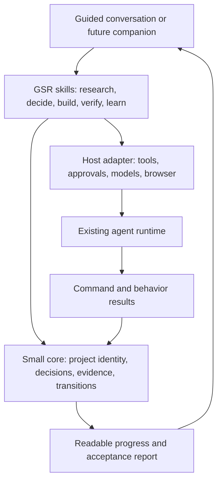

# GSR: a direction for the next stage

Research date: **2026-10-09**. Repository reviewed: **v0.5.0**, commit `fa92074c5044dfd0de9dda577ef5c53cf5bc2307`.

Review completed **2026-10-10**: repeated the appendix's isolated reproduction harness and confirmed its reported results; checked all 107 local-file and pinned-source references across the four reports. External documentation is the access-dated October 9 snapshot.

Status: **research and proposed plan, awaiting founder decisions**. This document does not authorize implementation or replace the current product scope. Only research documents were added during this investigation.

**Backlog preserved on 2026-10-11:** the [research backlog](../../BACKLOG.md) records 34 candidate work items, larger deferred investment hypotheses, dependencies, revisit triggers, and a source-coverage map. The reliability plan and adaptive-workflow specification are the next two workstreams; they are not the entire product roadmap. Subsequent plans must select backlog IDs explicitly and retain the remaining opportunities.

## Recommendation

Make GSR exceptionally good at coordinating the complete process of creating and improving products with AI: research, decisions, skill selection, implementation, verification, and continuity.

The proposed promise is: **“GSR remembers and runs the whole process, adapting the collaboration to you.”**

Founder clarification on **2026-10-10**: GSR should serve both beginners and power users. The founder is an experienced AI user and especially values having research and multiple skills coordinated within GSR without having to remember and invoke each one. This supersedes the initial beginner-first positioning. The supporting audit reports remain access-dated research; their beginner hypotheses do not define the whole audience.

Keep human ownership, useful research, explicit intent, accumulated corrections, and evidence. A beginner benefits from explanations and concrete demonstrations. An experienced user benefits from concise trade-offs, preserved technical choices, and longer authorized execution without managing the process manually. Both need dependable verification and continuity.

The strongest next investment is **adaptive coordination of the existing workflow, backed by reliable state and evidence**. Automatic skill selection is central to the product's value. Simplifying internal instructions should improve relevance and remove contradictions while preserving this complete service.

The audience is people creating or evolving products with AI, across experience levels. Familiarity with AI, software engineering, and the project's domain can differ within the same person. Validate beginner and power-user journeys separately; do not assume one interaction style serves both. The business model and future distribution channel remain open.

## Recommended next product increment

Deliver a bounded improvement to the existing plugin before considering a new application. The flagship experience is: **state the outcome once; GSR coordinates the relevant work, remembers the agreed boundaries, and returns with a checked result or a meaningful decision.** Existing explicit commands remain direct entry points.

| Priority | Proposed change | Concrete user benefit | Acceptance scenario |
|---|---|---|---|
| P0 | Repair installation, gate results, project identity and evidence freshness; reconcile conflicting rules | The product can support its current reliability promise | An installed hook executes; an echo or failed check cannot qualify as proof; code changes and restarts do not preserve unjustified success |
| P1 | One context-aware start/continue path over existing skills | Users need not remember which command or skill comes next | An idea, an existing-product change, and an interrupted task each take the appropriate path without manual phase navigation |
| P1 | Collaboration adapts to the task and expressed preferences | Beginners get guidance; power users get concise decisions and authorized execution | A supplied expert brief is honored without redundant intake; a person asking for guidance gets explained choices; a later request for closer review is respected |
| P1 | Research and skills are selected and reused deliberately | GSR owns process completeness without unnecessary repeated work | A new capability triggers needed research and relevant skills; a small known correction reuses context; changed constraints reopen affected findings |
| P1 | Durable decisions, constraints, next action and revision-specific evidence | Returning or changing direction does not mean explaining the project again | After a restart, GSR identifies what is agreed, what changed, what remains unverified, and the next authorized action |
| P2 | Demonstrations, assumption experiments and first-use support | Users can judge uncertain choices and reach actual use | A preview resolves a relevant D-pin; a release or local installation completes its intended core journey |

Example power-user instruction: “Add team subscriptions. Use our existing Stripe integration, research the seat-change edge cases, follow the current design system, and work through implementation and tests. Come back for pricing decisions or changes outside that scope.” GSR should retain those constraints, select applicable research/skills, execute the authorized work, and provide evidence. It should not repeat settled stack or process questions. This is an illustrative future acceptance scenario, not a claim about existing automatic behavior.

Example guided instruction: “I want clients to book appointments, but I don't know where to start.” The same workflow helps establish a small outcome, explains consequential choices, and offers defaults or deferral. It should not require the user to choose an engineering mode first.

The user's requested depth and authorization persist across sessions and can change per task. “Explain this part,” “show me alternatives,” or “continue within the approved plan” should be sufficient steering. Preferences about verbosity or expertise are not permission to spend money, publish, or change consequential product decisions.

Implementation shape to evaluate: concise skill entry points and references for reasoning, plus a small shared executable component for project discovery, state validation and evidence. Reuse host execution and browser capabilities. No new coding runtime is proposed for this increment.

## What this research establishes

The investigation covered executable hooks, installation, packaging, tests and CI; command and skill flows; templates, architecture, decisions and backlog; both archived user reports; and current primary documentation for eight competing workflows plus relevant agent technologies. Existing repository checks and isolated hook probes were run. No paid model benchmark, new user interview, production deployment, or hands-on competitor trial was performed.

Evidence is separated into:

- **Reproduced:** observed in local executable tests, including isolated hook-event fixtures.
- **Source-confirmed:** directly present in the current implementation or instructions.
- **Historical feedback:** useful qualitative evidence from earlier releases.
- **Hypothesis:** a proposed product or architecture improvement that needs validation.

Supporting reports:

- [Implementation audit and reproductions](2026-10-09-implementation-audit.md)
- [Workflow audit and user evidence](2026-10-09-workflow-audit.md)
- [Current market landscape](2026-10-09-market-landscape.md)

## Phase 1 refinement after the founder's friction requirement

The [October 11 handoff](2026-10-11-phase-1-handoff.md) narrows the broader delivery suggestions in this strategy into seven ordered tasks. It makes lightweight collaboration an acceptance requirement: no new mandatory mode, questionnaire or routine approval; honor existing task authorization and requested review depth. Installation, trustworthy checks and basic continuity support fewer interruptions and accurate completion. The handoff contains technical decisions, file boundaries, tests and an implementation-start prompt. The founder subsequently authorized the selected Phase 1 slices, now implemented in the working tree; [actual evidence](2026-10-11-phase-1-implementation.md) distinguishes passing deterministic checks from outstanding live host/model validation. The [full backlog](../../BACKLOG.md) retains all other opportunities.

## Preserve what is already good

GSR already has progressive questions, D-pins, project weights, quick tasks, batch builds, saved plans and debug sessions, spec/quality reviewers, browser walkthroughs, and optional notifications. Adding these again would create noise. The opportunity is to make them coherent, reliable, and easier to experience.

The existing nontechnical tester valued research insights, speed, relatively low token consumption, UI quality, and keeping project knowledge together. Their memorable criticism was that GSR moved toward the goal while GSD guided them toward it. That suggests a useful direction, but the report tested **v0.1.x**, and most listed problems are marked fixed in v0.2. The second tester was a developer building a small desktop demonstration. These two reports do not establish how current beginners fare on v0.5. [Original feedback](../feedback/user-1-imposition-tool.md), [second report](../feedback/user-2-dtmf-app.md).

The July backlog already proposes CI verification, shipping, spec import, runtime monitoring, and memory integration. This plan reprioritizes and develops those ideas; it does not claim to discover them. [Existing backlog](../../../gsr/docs/backlog.md).

## The code reveals a trust gap worth fixing first

`npm run check` passed: syntax, JSON, documentation links, version consistency, and all **10 hook tests**. Those tests do not establish end-to-end workflow correctness. The audit reproduced failures that the current suite misses.

| Finding | Evidence and limits | Consequence |
|---|---|---|
| Installed statusline cannot parse | Installer puts a version comment before a shebang. Temporary installation followed by `node --check` fails on line 2. [Installer L65](https://github.com/kmajerowicz/get-shit-right/blob/fa92074c5044dfd0de9dda577ef5c53cf5bc2307/gsr/hooks/install.js#L65). | Installation reports success while the statusline and its context-metrics feed cannot run. |
| A command name counts as verification | Tracker clears its dirty flag when command text matches a regex; `echo "npm run build"` qualifies in hook fixtures. It does not read command results or track all required checks. [Tracker L18](https://github.com/kmajerowicz/get-shit-right/blob/fa92074c5044dfd0de9dda577ef5c53cf5bc2307/gsr/hooks/gsr-gate-tracker.js#L18). | The commit reminder can disappear without any real verification. |
| Evidence does not follow actual code changes | Only three edit tools mark dirty; shell changes are missed. The bridge is session-keyed and missing state defaults to clean. New-session and cross-project cases were reproduced with fixtures. [Tracker L16](https://github.com/kmajerowicz/get-shit-right/blob/fa92074c5044dfd0de9dda577ef5c53cf5bc2307/gsr/hooks/gsr-gate-tracker.js#L16), [guard L19](https://github.com/kmajerowicz/get-shit-right/blob/fa92074c5044dfd0de9dda577ef5c53cf5bc2307/gsr/hooks/gsr-gate-guard.js#L19). | A user can see apparent completion after unverified changes or a restart. |
| Wording resembles evidence | Stop guard accepts fabricated text with a checkmark and arrow; “Done! It works.” does not match its prohibited phrases. [Guard L6](https://github.com/kmajerowicz/get-shit-right/blob/fa92074c5044dfd0de9dda577ef5c53cf5bc2307/gsr/hooks/gsr-redflag-guard.js#L6). | It is a language reminder, not proof that the product works. |
| Supported project layouts are inconsistent | `learn` recognizes alternate documentation roots, but hooks and later flows hardcode `docs/`. [Learn L35](https://github.com/kmajerowicz/get-shit-right/blob/fa92074c5044dfd0de9dda577ef5c53cf5bc2307/gsr/skills/learn/SKILL.md#L35). | Onboarding can succeed while later state detection fails. |

Important qualification: an early probe injected a failed result directly into the normal post-tool hook. That demonstrates the hook ignores result fields, but does **not** establish how a real Claude session dispatches failed commands. Current Claude documentation describes a separate `PostToolUseFailure` event. The stronger findings above do not depend on that synthetic failed-command event. [Official hook lifecycle](https://code.claude.com/docs/en/hooks).

There are protocol gaps too. Weight-specific permission to proceed conflicts with unconditional approval gates; the README's existing-product path goes from `learn` to `build`, although `learn` does not create the feature file `build` expects; research is categorically skipped on PRD updates even if the relevant facts changed. “Spec drift” has inconsistent definitions, and finding a pin in a comment does not demonstrate its behavior. Details and exact references are in the workflow audit.

These issues argue for a small executable foundation and scenario tests. More emphatic “Iron Laws” would not repair them.

## What changed around GSR

Current competitors have moved beyond the assumptions in GSR's March comparison. This table describes documented capabilities, not measured reliability.

| Alternative | Relevant current capability | Implication for GSR |
|---|---|---|
| GSD Core | Guided acceptance, saved state, and verification fingerprints that become stale after covered inputs change. [Verification guide](https://github.com/open-gsd/gsd-core/blob/main/docs/how-to/verify-and-ship.md). | Evidence freshness is a competitive baseline. GSR can improve its clarity and user value. |
| GitHub Spec Kit | An opt-in idea assessment progresses through research to an evidence-backed investment decision. [Assessment guide](https://github.github.io/spec-kit/guides/assessment.html). | Research and idea validation alone are not unique. |
| BMAD | Planning paths adapt to whether the idea is vague, clear, or a small change. [Planning paths](https://docs.bmad-method.org/plan/choose-a-planning-path/). | Avoid an outdated “everyone else is heavyweight” positioning. |
| OpenSpec | Iterative specification changes and broad agent integrations. [Repository](https://github.com/Fission-AI/OpenSpec). | Portable Markdown and multiple hosts are useful, but not a durable advantage alone. |
| Kiro | Requirements/design/tasks and requirement-linked property testing; the latter is currently IDE-specific. [Correctness](https://kiro.dev/docs/specs/correctness/). | Traceability must connect to executable behavior. |
| Lovable | Research-assisted planning, persistent editable plans, and real-browser tests. [Planning](https://docs.lovable.dev/features/plan-mode), [testing](https://docs.lovable.dev/features/browser-testing). | A beginner can already obtain much of this inside an integrated builder. |
| Replit | Planning, supported-app browser testing, publishing and live operations. [Planning](https://docs.replit.com/features/agent/plan-mode), [testing](https://docs.replit.com/features/agent/app-testing), [operations](https://docs.replit.com/features/publishing/after-you-publish). | Setup and launch are part of the competitive experience. |
| Bolt | Research in Plan Mode, contextual next actions, reusable skills and integrated app creation. [Planning](https://support.bolt.new/best-practices/plan-mode), [skills](https://support.bolt.new/building/skills). | Hosted builders may become distribution surfaces as well as competitors. |

The defensibility hypothesis is the **combination** of understandable decisions, preserved intent, reliable proof, and learning from use. It would have to be earned through measured user outcomes. No reviewed source establishes that this combination is exclusive to GSR.

## Five improvements worth pursuing

### 1. Let GSR coordinate the workflow at the user's chosen level of involvement

Propose one context-aware entry and continuation experience. Infer whether the person has an idea, materials, an existing product, or a bounded change. Explain the next useful outcome at the appropriate level and advance through already-authorized work. Keep existing commands as direct controls for users who prefer them.

Separate three concepts internally: the stakes of the project, the person's familiarity, and how much work they have authorized. A low-stakes project can have a technically experienced owner; a production project can have a beginner. The current weight dial cannot represent all three. Do not turn this into three new setup questionnaires: infer, explain briefly, and allow correction.

Choose review objects the person can meaningfully assess. A beginner can review a working preview and “customers can book without creating an account; here is what that changes.” An experienced user may explicitly want architecture choices, a diff, or detailed gate output. Honor that preference instead of hiding technical control. Existing technical review still happens; consequential product decisions remain visible.

Test both guided and concise/delegated collaboration inside the current host. Prefer natural-language steering and remembered preferences over a mandatory beginner/expert selector. A new standalone interface is a later investment decision.

### 2. Turn D-pins into experiments that make decisions easier

Extend the existing assumption ledger with the question to resolve, consequences of being wrong, cheapest useful experiment, observed result, and affected requirements. Use research for questions that sources can answer; use a preview for interaction questions; use real people for demand and usability questions.

For a printing tool, uncertainty about supported paper sizes should lead to inspecting representative jobs and testing a small real file-processing path. A working upload → transform → output slice reveals more than several attractive disconnected screens. Mark simulated services and disposable prototypes clearly. Before implementation becomes expensive, validate technical feasibility where the domain is demanding.

The proposed sequence is: establish the goal and constraints → investigate the highest-impact uncertainty → agree a small demonstrable outcome → build and observe it → confirm or revise decisions → expand the spec. Detailed planning remains valuable where mistakes are costly. This is an extension of PRD-first discipline that permits evidence to improve the PRD early.

Web research can establish alternatives, constraints and documented capabilities. It cannot establish willingness to pay or product-market fit. Agent-simulated customers can suggest interview questions; they do not replace customer evidence.

### 3. Give every important product promise inspectable proof

Extend pins from identifiers into an acceptance record. Distinguish:

- implementation located;
- automated behavior verified for a particular revision;
- observed in the running application;
- accepted by the user;
- failed, stale, or still unverified.

A grep match remains useful evidence of a connection; it cannot alone prove that a customer can complete an action. A green screenshot cannot alone prove that data was persisted. Critical journeys should combine interaction with the appropriate application/API/data assertion.

Present a simple report: **what now works, how it was checked, what still needs your judgment**. Keep commands, screenshots and detailed results available underneath. A relevant code or requirement change makes old proof stale. If impact analysis is uncertain, rerun the broader required checks. A manual override must remain visibly unverified rather than manufacturing a passing result.

This develops the existing visual tier and pins. It is not a proposal to add browser verification for the first time.

### 4. Make research accumulate around decisions

Replace repeated broad research with a small reusable record: question, factual claim, direct source, observed date, confidence, counterevidence, applicable constraints, and the decision it informs. Refresh only when a change or age makes the finding unreliable. Never apply a universal “research already happened” rule.

Use stronger reasoning for contradictory sources, hidden domain constraints, consequences, and selecting the next experiment. Use bounded agents for independent questions. Stop when the decision has enough evidence, the budget is reached, or the remaining uncertainty requires a person or experiment. More sources and more agents are not success metrics.

Apply the same discipline to skills: reuse relevant installed skills first, load only the guidance needed for the task, and discover additional capabilities when there is a concrete gap. Avoid running a marketplace search on every routine edit. Record relevant choices so the user does not have to reconstruct a collection of skills each session. Respect installation and tool permissions; automatic selection does not imply automatic authorization for every external action.

For the founder, the valuable accumulating asset could become a consented library of real failure cases, domain examples and evaluated workflow improvements. A skills marketplace should not be the first move; a small set of tested reference projects can teach more.

### 5. Carry the user through first use and the next change

Expand existing deployment guidance into a complete first-use milestone: service setup, preview, a live core-journey check, release readiness appropriate to the stakes, and a clear route for reporting problems. Distinguish “runs locally,” “published,” and “used successfully.” Include relevant operating-cost assumptions and a recovery path.

After release, connect actual feedback to the original goal and requirement. Propose a change, explain affected decisions, and reverify the impacted behavior. This completes the existing feedback/backlog mechanism with an evidence-based learning loop.

For a personal desktop utility, first use may mean opening it successfully on the intended machine. Do not impose hosting, analytics or business metrics on every project.

## How stronger models and current technology help

The model upgrade should be tested together with the workflow. OpenAI's September guidance specifically recommends reconsidering elaborate skill recipes, overly broad activation, and obsolete approval boundaries for GPT-6 Astra. Anthropic's application-harness experiments likewise show that useful scaffolding can change with a stronger model, and that independent evaluation has costs and limits. These support an **experiment**, not indiscriminate removal of constraints. [OpenAI prompting guidance](https://developers.openai.com/blog/rethinking-skills-and-prompts-for-gpt-6-astra), [Anthropic harness experiments](https://www.anthropic.com/engineering/harness-design-long-running-apps).

| Capability | Concrete GSR use | Recommended stance |
|---|---|---|
| Strong reasoning models | Ambiguous scope, consequence analysis, difficult debugging, evidence critique | Compare on GSR scenarios; use extra effort where outcomes improve. |
| Multimodal reasoning and browser tools | Explain visual alternatives and inspect actual user journeys | Combine with deterministic assertions; keep taste and user acceptance human. |
| Portable skills | Share product-method instructions across hosts | Adopt the standard, with explicit host requirements and tested adapters. [Agent Skills specification](https://agentskills.io/specification). |
| Playwright CLI/skills and MCP | Repeatable tests plus exploratory browser inspection | Prefer recorded tests for repeatable assertions; choose CLI or MCP by host capability and task. Microsoft's docs describe both approaches. [Playwright guidance](https://github.com/microsoft/playwright-mcp), [assertions](https://playwright.dev/docs/test-assertions). |
| Codex SDK / App Server and Claude Agent SDK | A future guided companion that reuses existing agent execution | Evaluate one host first; avoid building a new coding-agent loop. [Codex SDK](https://learn.chatgpt.com/docs/codex-sdk), [App Server](https://learn.chatgpt.com/docs/app-server), [Claude SDK](https://code.claude.com/docs/en/agent-sdk/overview). |
| Managed agent runtimes | Hosted sessions, tools and execution if setup proves a major blocker | An option for a later hosted product, with billing, environment and portability implications. [OpenAI runtime choices](https://developers.openai.com/api/docs/guides/agents), [Anthropic managed architecture](https://www.anthropic.com/engineering/managed-agents). |
| Workflow evaluation tooling | Compare prompts, models, recovery and completion quality | Start with existing fixtures and a small end-to-end runner; Promptfoo is a candidate for model/prompt comparisons, not a substitute for application tests. [Promptfoo](https://www.promptfoo.dev/docs/intro/), [OpenAI agent evaluation](https://developers.openai.com/api/docs/guides/agent-evals?trk=public_post_comment-text). |

Concrete model candidates at the research date include GPT-6 Astra and GPT-6.1 Sol, and Claude Opus 5.5 / Sonnet 5.5; Anthropic also documents Fable 5.1 for demanding work. These are candidates from provider catalogs, not a GSR performance ranking. Host and account access must be checked. GSR's current `opus`/`sonnet` role aliases are not evidence of a particular resolved version. [OpenAI catalog](https://developers.openai.com/api/docs/models), [Claude catalog](https://platform.claude.com/docs/en/models/overview).

Begin with a capable general model and selective escalation. Test whether an independent verifier catches additional consequential failures. Reserve parallelism for independent research or genuinely separate tasks; keep a single writer for shared project state. Do not automatically add several review loops to every small edit. Compare cost per accepted working outcome, including retries and user interruptions.

Portability has a material distribution constraint: current OpenAI plugin documentation allows lifecycle hooks for manually installed Codex desktop plugins but excludes hook-containing plugins from the public directory. Loading GSR's migrated skills here does not prove equivalent enforcement. A portable product needs an explicit capability matrix and an enforcement path appropriate to each host. [Plugin packaging and hook limits](https://developers.openai.com/plugins/build/plugins).

## A small architectural direction, if validated

Keep product intent in readable, versioned documents. Add a small deterministic layer for facts that should not depend on how an agent phrases a message:

Proposed evidence records would contain project/worktree identity, pin and requirement revision, covered input hashes, check identity, exact command, exit status, time, result artifacts, and evidence type. This is an architectural proposal, not a schema implemented here.

Avoid two competing truths. Product intent remains authoritative in the spec; execution results are authoritative in an append-only evidence record. Progress summaries are derived views. Use atomic writes and a single-writer convention initially; add more complex storage only when concurrency requires it. A restored session reconciles documents, actual files and recorded evidence before announcing the next step.

This core supports correctness; it is not by itself a security boundary against a malicious actor who controls the files. CI or a separate trusted runner would be needed for stronger assurance. For initial GSR use, the target is reliable execution and honest claims under ordinary agent mistakes.

## Proposed order of work and decision gates

The stages below are recommendations. They are not approved development tasks or delivery-date estimates.

| Stage | Work | Evidence required to advance |
|---|---|---|
| A — Establish the baseline | Observe beginners and experienced AI builders, including the founder; capture representative scenarios and process reminders; reproduce installation/evidence defects | Outcomes and current friction documented separately for both experience groups |
| B — Make the foundation dependable | Repair installed-hook execution and gate semantics; unify project root/configuration; resolve conflicting workflow rules; test restart and changes after verification | All known failure fixtures caught; installed artifact smoke passes; no false PASS in the agreed regression set |
| C — Prove adaptive coordination | One start/continue path across idea, existing-product change and resumed work; relevant research/skills selected; preferences retained; evidence reported | Beginners finish with less confusion; power users need fewer process reminders and redundant approvals; both retain ownership |
| D — Reach first real use | Guided provisioning and launch/installation for the selected project type; live verification; feedback-to-change loop | Users reach an actual intended user or personal use without founder rescue; failures have a recovery path |
| E — Expand distribution selectively | One additional tested host, or a companion interface if observed setup friction justifies it | Capability parity is explicit and the new surface improves activation enough to justify maintenance |

Begin usability research during A, in parallel with designing the reliability work. Do not spend months hardening an engine without testing the experience, and do not broaden distribution before knowing whether people succeed.

Three product shapes remain open:

| Shape | Advantage | Cost / dependency | Recommendation |
|---|---|---|---|
| Adaptive plugin on existing hosts | Fastest way to test complete process coordination; preserves repo ownership and direct controls | Host installation and UI limits remain | Start here for the next experiment |
| Local companion using a host SDK | Can make decisions, previews and progress easier to navigate | Authentication, updates, process lifecycle and packaging become GSR work | Prototype only if host interaction is a demonstrated blocker |
| Hosted product | Can remove local setup and integrate launch | Compute costs, credentials, isolation, abuse handling and operational support | Defer until demand and economics are clearer |

## Validation plan before choosing a large roadmap

**1. Observe current users.** Start with the founder's next real GSR task, then a proposed exploratory cohort of 6–8 people split between beginners and experienced AI builders. Include unfamiliar-domain tasks for experienced users and some first-time AI-tool installation sessions. Use real bounded tasks where feasible. Record consented observations, stalls, facilitator interventions, misunderstandings, process reminders, overridden preferences, meaningful decisions and completion. Analyze the groups separately. This small sample provides qualitative discovery, not statistically representative group comparisons.

**2. Build a reference scenario set after approval to develop.** Start with roughly 12 scenarios and at least three trials for variable agent behavior. Keep these proposed sizes adjustable to budget. Include a printing/file-processing task, a small personal desktop tool, a straightforward web workflow, and an existing-product change. Inject failures:

- “I don't know yet” and a later change of mind;
- “build all” followed by an unrelated clarification;
- shell mutation or requirement change after a passing check;
- failed, skipped or fabricated verification;
- missing browser tools or unavailable external service;
- a restart with incomplete work and stale evidence;
- a custom documentation root;
- an existing codebase with no feature spec;
- new constraints that invalidate old research;
- user feedback that contradicts the initial plan.
- a complete expert brief with settled stack, research needs and explicit execution boundaries;
- a power user requesting close review of design but autonomous execution of tests;
- a beginner becoming confident and asking for shorter explanations;
- a routine change where existing research and skills suffice.

**3. Separate the effects of model and workflow.** On a small representative subset, compare current GSR with an adaptive variant using the same model, tools and starting files. Score beginner and power-user scenarios separately. Separately compare capable model profiles on the same workflow. Include the host without GSR as a baseline: otherwise improvements may simply reflect the model. Repeat trials and review failures. Keep held-out scenarios, use deterministic behavior tests where possible, and calibrate human/model scoring against real examples. [Anthropic's evaluation guidance](https://www.anthropic.com/engineering/demystifying-evals-for-ai-agents).

**4. Measure outcomes that match the promise.**

| Metric | What it answers |
|---|---|
| Accepted working core journey | Did the intended behavior actually work on the reviewed revision? |
| Time to first useful demonstration | How long before the person can judge a real outcome? |
| False completion rate | Did GSR claim success while a required check was failed, stale or absent? |
| Decision comprehension | Can the person explain the important choice and its consequence? |
| Unsupported product choices | Did the agent silently decide something beyond the user's authority or recorded deferral? |
| Confusing interruptions / facilitator rescues | How much workflow knowledge did the person need? |
| Process reminders and repeated instructions | Did the user have to ask for research, skill use, testing or a previously agreed constraint again? |
| Preference adherence | Did GSR preserve the requested depth, technical choices and review boundaries? |
| Cost and elapsed time per accepted outcome | Did stronger models/reviewers pay for themselves after retries? |
| First use and return to change it | Did the result survive beyond the demo? |

Proposed release conditions: zero false PASS on the critical deterministic regression set; no unrecorded consequential product choices in reviewed trials; fewer confusing interruptions for beginners and fewer process reminders/redundant approvals for experienced users, without lower working-outcome success in either group. Set numerical improvement thresholds after measuring the baseline. Zero failures in a small suite is not a universal reliability claim.

If users like the preview but cannot launch, prioritize provisioning. If they never get through installation, test a different surface earlier. If they complete tasks but misunderstand decisions, improve explanations and evidence. If the unmodified host performs just as well, narrow GSR to the task classes where it adds measurable value.

## What to postpone

Do not start with a standalone IDE, a large agent hierarchy, a public skills marketplace, fine-tuning, a vector-memory platform, or exhaustive support for every host and stack. There is no evidence in this investigation that any of these solves the main user problem. The reusable corpus and evals needed for some of them do not yet exist in the repository.

Also avoid automatic growth of Learned Rules. Corrections should be scoped, deduplicated, and checked against later evidence; adding every local preference to global instructions can slow or misdirect stronger models. Preserve decisions and examples while keeping the active instruction set small.

## Founder decisions still open

1. Which real founder task and beginner task should be the first paired pilot? The product audience includes both; the experiment needs bounded examples.
2. For those pilot tasks, is success a useful personal tool, a published prototype, or a product serving external users?
3. Should GSR remain primarily an open-source method/plugin, or eventually become a guided commercial product? Current research does not establish willingness to pay.

My recommendation is to strengthen the existing plugin around adaptive process coordination and trustworthy evidence. Begin with the reproduced reliability defects and a paired pilot: an experienced user's real task and a guided beginner task. The next planning artifact should specify the bounded increment above with acceptance scenarios for both. Broader launch support and additional surfaces follow evidence from that pilot. Implementation remains unapproved in this research phase.

## Phase 2 refinement — 2026-10-11

The [Phase 2 handoff](2026-10-11-phase-2-handoff.md) specifies a bounded Stage C
increment: one optional start/continue entry over existing skills, the focused
existing-product feature-spec bridge, relevant installed skill selection, reusable
research and continuous task handoffs. Existing direct commands remain available;
no expertise selector or repeated routine approval is proposed. Eight ordered tasks
and C1–C12 scenarios define file boundaries, verification and explicit remainders.

This is planning-only authorization. Phase 2 implementation and actual host/model
observations have not happened. The Phase 1 live-validation gap is carried forward;
first-use/deployment, model routing, pin lifecycle redesign, companion interfaces
and distribution remain separate backlog candidates.

### Context-boundary clarification — 2026-10-13

The founder clarified that `/clear` followed by a next-stage command is deliberate:
large tasks need fresh context after work stages. The revised
[Phase 2 contract](2026-10-11-phase-2-handoff.md) preserves these boundaries and
improves durable stage handoffs and next-step coordination across sessions. It does
not promise uninterrupted end-to-end execution or automatic session creation. This
corrects the later proposal to remove stage resets; lightweight collaboration still
means avoiding repeated authorization and history reconstruction, not removing
preventive context hygiene.

### Preferred continuation — 2026-10-13

The founder endorsed a compact next-stage start packet, `/clear`, then **"dalej"**.
The coordinator chooses the saved next step, reloads relevant documents/guidance and
preserves constraints/review cadence. Large builds use bounded checkpoints. Direct
commands remain available; actual bare-message resume and minimal-context loading
must be evaluated on the host, not assumed from prompt text or a saved file. This
refines Phase 2 planning; it does not authorize implementation or automatic sessions.

### Bounded implementation — 2026-10-13

The later founder instruction "działaj z implementacją Fazy 2" authorized the handoff's
bounded code/docs/local verification scope. Its selected slices are now implemented
in the working tree: [implementation evidence](2026-10-13-phase-2-implementation.md)
records 40 passing deterministic tests and observed isolated native startup. Actual
interactive clear/bare "dalej" and C1–C12 model behavior remain unobserved; this is
implementation completion, not full phase validation or measured product benefit.
Historical planning statements above retain their original context. Deferred backlog,
release, paid evaluation and automatic session lifecycle remain outside this delivery.
