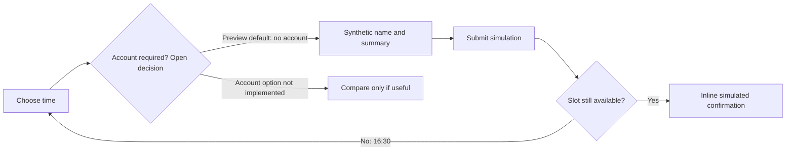

# Booking preview: is an account needed?

This synthetic example demonstrates a product flow and a local interaction. It is
not a prescribed application stack/design and does not implement booking storage.
Use the same approach with the actual domain, existing components and user constraints.

## Open the example

Open `index.html` in this folder directly in a browser; it uses only the adjacent
`preview.js` and inline CSS, with no external dependency. Alternatively, from the
repository root run `python3 -m http.server 8765 --bind 127.0.0.1 --directory gsr/examples/product-preview` and visit
`http://127.0.0.1:8765/`.

Choose a time, submit, then choose another time. The 16:30 option simulates a race
where the selected slot becomes unavailable. Keyboard path: Tab to the time group,
arrow keys to select, Tab to the synthetic name, then the submit button. Confirmation
moves focus to its message; the reset button returns focus to the first time.

## Product map

Text fallback: choose time → account decision (open; this version tries no account)
→ synthetic name/summary → submit → inline simulated confirmation. If the slot has
become unavailable (16:30), show the error and select another. The alternative with
an account is not implemented or selected by the user.

## Question, assumptions and limits

Question: can the user judge the no-account flow and inline confirmation before a
full application build? Preview revision: 2026-10-15. Material assumptions: one
30-minute meeting; no login in the demonstrated path; confirmation inline. These are
synthetic inputs, not confirmed business requirements. No user feedback received.

Works locally: choosing a time, summary update, native name validation, success/error
message and reset. Simulated: availability and confirmation. Unimplemented/unverified:
storage, auth, email, real calendar, cancellation, payment and production accessibility.
Refreshing loses local page state. No service request, storage or production write occurs.

This shipped example has no project decision ledger. In a user project, requirements
belong in scope/feature/PRD and the actual account D-pin has one owner there; the
preview record links it. Do not create a second editable ledger here.

## Observations and feedback

Opening via the documented server was observed with HTTP 200 on 2026-10-15.
Browser visual/keyboard observations remain unobserved: CUA listed no browser and
the in-app browser was unavailable. The Node DOM harness checks handler behavior,
not layout, browser validation or real keyboard navigation. No product/user
acceptance or effectiveness claim. See the actual local behavior before adapting it.

Next action in a real task: collect only the needed feedback, update its authoritative
requirements and preserve any requested wait. Build disposition: **adapt** this example
only for an appropriate project; replace synthetic data and simulated availability/save
with actual integrations and corresponding tests. Copying this file is not a verified
booking backend and never authorizes deployment.
